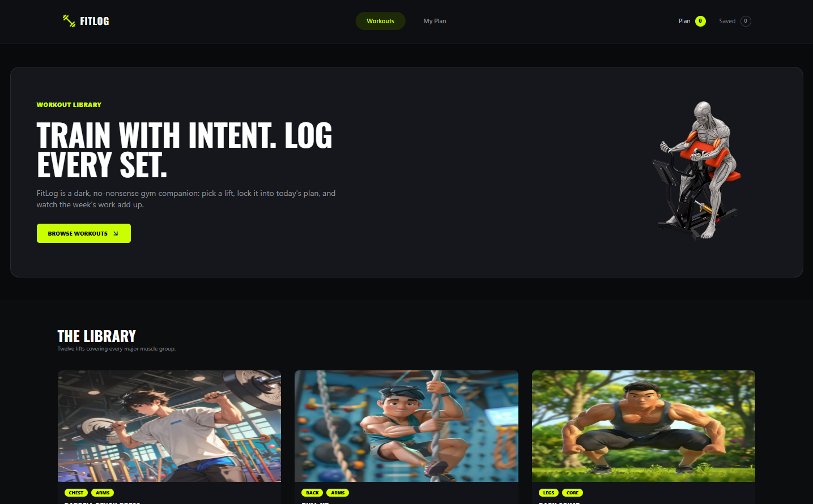
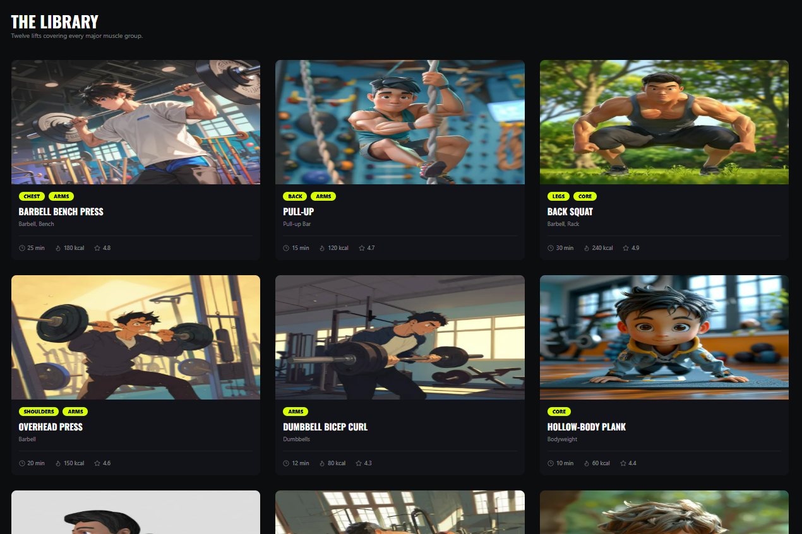
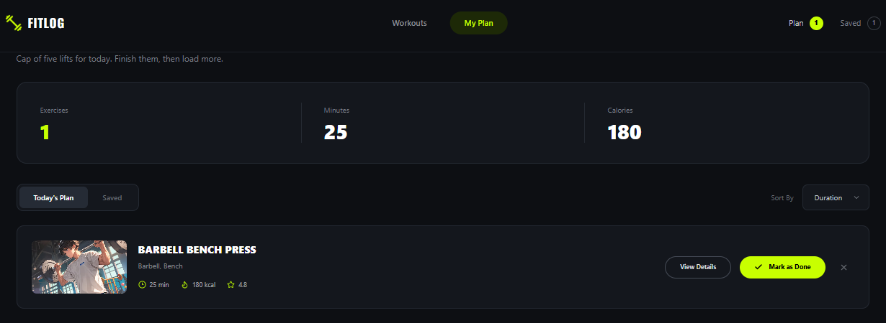

# 💪 FitLog: Workout Library & Daily Planner



FitLog is a workout library and daily planner. Browse workouts, open step-by-step exercise guides, build a daily plan of up to five workouts, save favourites for later and track your minutes and calories as you finish each exercise. Your plan stays saved even after you close the browser.

**🔗 Live site:** https://fitlog-blond-xi.vercel.app

---

## 📌 Overview

Most workout apps are either too complex or just a list of exercises. FitLog sits in between: pick what you want to do today, see exactly how to do it, tick it off when you're done and watch your progress update in real time. There's no sign-up, and everything is stored in your browser.

---

## ✨ Key Features

- 🏋️ **Workout library:** 12 workouts loaded from an API, with muscle groups, equipment, difficulty, duration, calories and rating.
- 📖 **Workout details:** sets, reps, specs and step-by-step instructions for every workout.
- 📅 **Today's Plan:** add up to **5 workouts** a day, with duplicate protection and toast feedback.
- 🔖 **Saved workouts:** bookmark workouts for later in a separate tab.
- 📊 **Live metrics:** total exercises, minutes and calories update instantly, and the navbar counters stay in sync.
- ↕️ **Sorting:** sort your plan and saved list by duration, calories or rating.
- ✅ **Mark as done / remove:** track progress through the day.
- 💾 **Persistent data:** your plan and saved workouts survive page reloads (localStorage).
- 📱 **Responsive design:** loading states, error handling and a custom 404 page.

---

## 📸 Screenshots

| Workout library | My Plan |
|---|---|
|  |  |

---

## 🛠️ Tech Stack

| Technology | Purpose |
|---|---|
| **Next.js 16** (App Router) | Routing and server-side data fetching |
| **React 19** + **TypeScript** | UI and type safety |
| **React Context API** | Shared plan, saved list and metrics state |
| **Tailwind CSS 4** + **DaisyUI 5** | Responsive styling and components |
| **localStorage** | Saving data between visits |
| **react-hot-toast** · **lucide-react** | Notifications and icons |
| **Vercel** | Hosting |

---

## 📦 Dependencies

```text
next 16.3.6              react / react-dom 19.2.8
daisyui ^5.7.44          lucide-react ^1.48.0
react-hot-toast ^2.6.1
```

**Dev:** typescript ^5 · tailwindcss ^4.3.3 · @tailwindcss/postcss · eslint ^9 · eslint-config-next

---

## 🚀 Run Locally

**Prerequisites:** Node.js 20+ and npm. No environment variables are needed.

1. **Clone the repository**
   ```bash
   git clone https://github.com/Istiak0614/fitlog.git
   cd fitlog
   ```

2. **Install dependencies**
   ```bash
   npm install
   ```

3. **Start the development server**
   ```bash
   npm run dev
   ```

4. Open **http://localhost:3000**

To test a production build:

```bash
npm run build
npm start
```

---

## 🧭 Routes

| Route | Description |
|---|---|
| `/` | Hero banner and the full workout library |
| `/workout/[id]` | Workout details and instructions, with Add to Plan / Save buttons |
| `/my-plan` | Today's Plan and Saved tabs with metrics and sorting |

---

## 🌐 API

Workout data comes from a public REST API:

| Endpoint | Returns |
|---|---|
| `GET https://api.abcz.workers.dev/api/fitlog` | All workouts |
| `GET https://api.abcz.workers.dev/api/fitlog/:id` | A single workout |

---

## 📁 Project Structure

```text
src/
├── app/
│   ├── page.tsx              # Home: hero + library
│   ├── workout/[id]/page.tsx # Workout details
│   ├── my-plan/page.tsx      # Plan & saved tabs
│   ├── not-found.tsx         # Custom 404
│   └── layout.tsx
├── components/               # Navbar, Hero, LibrarySection, WorkoutCard, Footer
├── context/PlanContext.tsx   # Plan, saved and metrics state + localStorage
├── types/index.ts            # Workout types
└── utils/api.ts              # API helpers
```

---

## 🔗 Links

- **Live site:** https://fitlog-blond-xi.vercel.app
- **Repository:** https://github.com/Istiak0614/fitlog
- **Author:** [Md. Istiak Hossain Ifti](https://www.linkedin.com/in/md-istiak-hossain-ifti/)
